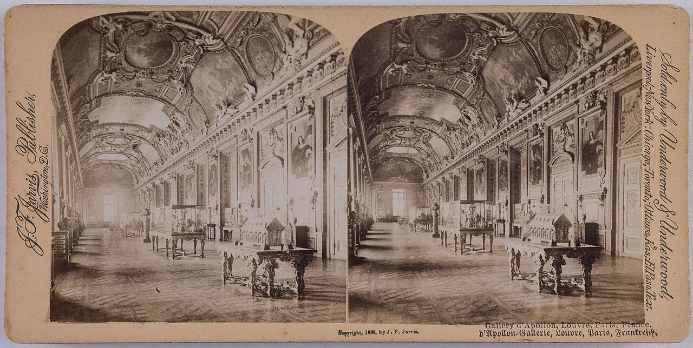

À la fin des années 1990, alors qu’il vivait au Congo, on offrit à Kader Attia un morceau d’étoffe kuba en raphia. Une déchirure y avait été réparée avec des pièces de tissu vichy, ce coton à carreaux de nappe de bistrot.[^1] Le raccommodage ne cherchait pas à se faire oublier. Il se voyait de loin, il changeait l’objet, il en faisait partie. De ce chiffon, Attia a tiré une pensée entière : il y aurait deux manières de réparer, celle qui efface la blessure et celle qui l’expose.

Le Louvre est aujourd’hui un objet déchiré. Le 19 octobre 2025, des cambrioleurs montés sur un camion élévateur sont entrés par une fenêtre de la galerie d’Apollon et sont repartis, en quelques minutes, avec des joyaux de la Couronne estimés à 88 millions d’euros.[^2] Trois semaines plus tard, la Cour des comptes reprochait au musée d’avoir privilégié les opérations visibles et attractives au détriment de la sécurité de ses collections. En février 2026, sa présidente, Laurence des Cars, a quitté ses fonctions ; Christophe Leribault lui a succédé.[^3]

C’est à ce Louvre-là que deux invités répondent cet automne. Kader Attia, qui a eu pendant deux ans un atelier dans le palais, y expose le fruit de sa résidence. Et Bénédicte Savoy, l’historienne dont le nom reste attaché au rapport de 2018 sur la restitution du patrimoine africain, occupe à partir du 16 novembre la Chaire du Louvre, sous un titre qui sonne comme une provocation et se termine comme une politesse : « Faut-il brûler le Louvre ? » Non.[^4]

La question que pose cette double invitation est simple. Quand une institution blessée programme sa propre critique, la désarme-t-elle ? La réponse, Attia l’a déjà donnée, dans un autre contexte : tout dépend de la manière dont on recoud.

## Deux manières de réparer

En 2012, à la Documenta de Kassel, Attia présentait *The Repair from Occident to Extra-Occidental Cultures*.[^5] Sur de longues étagères, il confrontait des objets africains réparés avec des matériaux exogènes, boutons ou tissus industriels, à des photographies de soldats défigurés pendant la Grande Guerre, les « gueules cassées », et aux premières tentatives de chirurgie réparatrice. Le rapprochement était violent et précis. D’un côté, une réparation qui garde la trace de la blessure et la transforme en histoire de l’objet. De l’autre, une médecine qui voulait rendre aux visages une apparence d’intégrité, comme si rien n’était arrivé.

Le musée occidental, observe Attia, appartient à la seconde famille. Il valorise l’original intact, la surface sans accident ; la restauration y réussit quand elle ne se voit pas. Les objets africains rapiécés qui dorment dans ses réserves le gênent pour cette raison même : la réparation y est une signature, et une signature qu’il ne sait pas lire.[^6] Attia en tire une conséquence qui dépasse l’ethnographie. Réparer, dit-il en substance, ce n’est pas seulement remettre en état, c’est traduire, c’est se réapproprier ce dont on avait été dépossédé. La réparation matérielle conduit, chez lui, à la réparation au sens politique : la restitution d’une perte infligée.[^7]

On voit le parti qu’on peut tirer de cette grille pour lire l’automne du Louvre. Il y a deux façons, pour un musée, d’inviter ses critiques. La première est une restauration invisible : la critique est accueillie, applaudie, filmée, et le musée en sort plus lisse qu’avant, comme un vernis neuf sur une toile craquelée. La seconde est un raccommodage en vichy : la critique est accueillie, et elle laisse une marque qui ne s’efface pas.

## Le Louvre regardé par celui qui l’a aimé

L’exposition d’Attia ne se présente pas comme un réquisitoire. Le musée la décrit comme un film et une installation nés de ses déambulations intimes dans le palais, une méditation sur la fluctuation des époques, des mémoires et des regards.[^8] Il faut se souvenir d’où vient cet artiste. Né en 1970 à Dugny, en Seine-Saint-Denis, il a raconté avoir eu sa révélation au Louvre, adolescent, un jour de gratuité, devant les tableaux des frères Le Nain et de Georges de La Tour.[^9] Celui qui revient au Louvre en hôte y est d’abord entré en visiteur pauvre.

Cette biographie compte. Attia n’est pas un critique extérieur qu’on aurait fait entrer pour l’apprivoiser : il est l’un des enfants que le musée gratuit a fabriqués. Sa présence dans la salle de la Chapelle, à côté des portraits d’Elizabeth Peyton, n’est pas une concession à l’époque. C’est la preuve vivante de ce que le Louvre a su faire de mieux, et de ce qu’il risque de ne plus faire quand il privilégie, selon le mot de la Cour des comptes, le visible et l’attractif. [À vérifier après visite : ce que le film et l’installation montrent effectivement, et s’ils regardent le musée avec la même tendresse que leur auteur.]

## Ce que Savoy demande au Louvre

Bénédicte Savoy, elle, vient avec des archives. Son titre emprunte à une enquête publiée au début des années 1920 par *L’Esprit nouveau*, la revue de Le Corbusier et d’Ozenfant, qui demandait déjà s’il fallait brûler le Louvre pour faire place au monde moderne.[^10] Ses cinq leçons remontent le fil de deux siècles de griefs : la centralisation, la provenance des collections, l’accumulation, la perte de sacralité. Les titres disent l’essentiel. « Trop voir, tout avoir. » « Voir et ne pas voir. Le Louvre et les angles morts du musée. » « Extraire. Le Louvre et l’envers matériel du musée. »

Ces griefs ne sont pas neufs. Paul Valéry, en 1923, se plaignait déjà, dans *Le Problème des musées*, de cette accumulation de chefs-d’œuvre qui épuise le regard au lieu de le nourrir.[^11] Ce qui est neuf, c’est que la critique ait désormais force de loi. Le rapport que Savoy a cosigné en 2018 avec Felwine Sarr a servi de canevas à un long travail législatif, achevé le 9 mai 2026 : la France dispose maintenant d’une loi-cadre qui autorise, par une procédure encadrée, la sortie des collections publiques des biens culturels appropriés de façon illicite entre 1815 et 1972.[^12] Savoy ne parle plus depuis la marge. Elle parle depuis un texte voté.

D’où l’ambiguïté de sa présence à l’auditorium. Inviter l’autrice d’un rapport devenu loi, c’est reconnaître que le débat est tranché. Mais c’est aussi lui offrir la plus belle scène du musée, et risquer de transformer une exigence en spectacle : on écoute, on applaudit, on rentre chez soi, et les vitrines restent pleines. Dès l’annonce de sa nomination, la presse notait qu’elle risquait de faire polémique.[^13] La polémique est le contraire d’une réparation. Elle consume l’attention et laisse l’objet intact.

> [!exergue] Une critique accueillie qui ne laisse pas de trace n’est pas une réparation. C’est une restauration.

## La vitrine vide

La dernière leçon de Savoy s’intitule « Droit dans les yeux. Le Louvre en face ». Le musée la présente comme la recherche d’un lieu « post-sacralisé », capable d’intégrer à l’expérience du visiteur l’histoire de la formation de ses collections.[^14] L’expression est juste, et elle oblige. Regarder le Louvre en face, ce n’est pas raconter l’histoire de ses acquisitions sur un cartel de plus. C’est accepter que certaines salles portent la trace de ce qui en est parti.

Le Louvre sait ce qu’est une vitrine vidée. Il l’a appris il y a treize mois, dans la galerie d’Apollon, et ne l’avait pas choisi.[^15] Les restitutions que la loi rend désormais possibles en produiront d’autres, choisies celles-là. Entre ces deux vides, il y a toute la différence entre une blessure subie et une réparation consentie.

C’est là que la grille d’Attia devient un test. Si l’automne du Louvre n’est qu’une restauration, on reconnaîtra le procédé : de belles leçons, une belle exposition, et un musée verni à neuf qui rouvre la galerie d’Apollon comme si rien n’était arrivé. Si c’est un raccommodage, il se verra. Il prendra la forme de salles où l’on explique pourquoi un objet n’est plus là, de cartels qui nomment les départs autant que les arrivées, d’une institution qui laisse paraître ses coutures.

Il y a près de trente ans, un tissu kuba apprenait à un artiste qu’un objet réparé n’est pas un objet diminué. Le Louvre a aujourd’hui le choix entre deux vitrines vides. L’une raconte un vol. L’autre pourrait raconter une réparation.

[^1]: L’épisode est rapporté par Kader Attia dans un entretien avec Ana Teixeira Pinto, publié à l’occasion de l’exposition *Repair. 5 Acts*, KW Institute for Contemporary Art, Berlin, 2013.
[^2]: Cour des comptes, rapport sur le musée du Louvre, novembre 2025 ; *Le Temps*, « Le vol du Louvre, un signal d’alarme assourdissant », novembre 2025.
[^3]: LCP, compte rendu de la commission d’enquête de l’Assemblée nationale sur le casse du Louvre, 2026.
[^4]: Musée du Louvre, présentation de la Chaire du Louvre 2026 : « Le Louvre, grandeur et contradictions. Fragments pour une histoire critique des musées au 21ᵉ siècle », cinq conférences du 16 au 30 novembre 2026.
[^5]: Kader Attia, *The Repair from Occident to Extra-Occidental Cultures*, installation, dOCUMENTA (13), Kassel, 2012.
[^6]: « The Repair from Occident to Extra-occidental Cultures: Reinvention and Reconstruction in the Work of Kader Attia », article déposé sur HAL Sciences Po. [À vérifier : auteur et revue d’origine.]
[^7]: Kader Attia, entretien cité par Lehmann Maupin, « Political Art: Kader Attia at the Museum für Moderne Kunst Frankfurt ».
[^8]: Musée du Louvre, présentation de l’exposition *Les Hôtes du Louvre. Kader Attia et Elizabeth Peyton*, salle de la Chapelle, 24 septembre – 14 décembre 2026.
[^9]: *The Brooklyn Rail*, notice de Kader Attia, 2026. Attia disposait d’un atelier au pavillon de Flore.
[^10]: Musée du Louvre, présentation de la Chaire du Louvre 2026. *L’Esprit nouveau* a été fondée en 1920 par Le Corbusier, Amédée Ozenfant et Paul Dermée. [À vérifier : date exacte et numéro de l’enquête.]
[^11]: Paul Valéry, « Le Problème des musées », 1923, repris dans *Pièces sur l’art*, Paris, Gallimard.
[^12]: Loi n° 2026-351 du 9 mai 2026 relative à la restitution de biens culturels ayant fait l’objet d’une appropriation illicite. Felwine Sarr et Bénédicte Savoy, *Restituer le patrimoine africain*, rapport remis au président de la République, novembre 2018.
[^13]: *Paint and Painting*, « Bénédicte Savoy holder of the Louvre Chair in 2026 », d’après une information du *New York Times*.
[^14]: Musée du Louvre, présentation de la conférence « Droit dans les yeux. Le Louvre en face », 30 novembre 2026.
[^15]: Selon la commission d’enquête de l’Assemblée nationale, les joyaux n’avaient pas été retrouvés à la date de son rapport. [À vérifier : état de l’enquête à la date de publication.]
